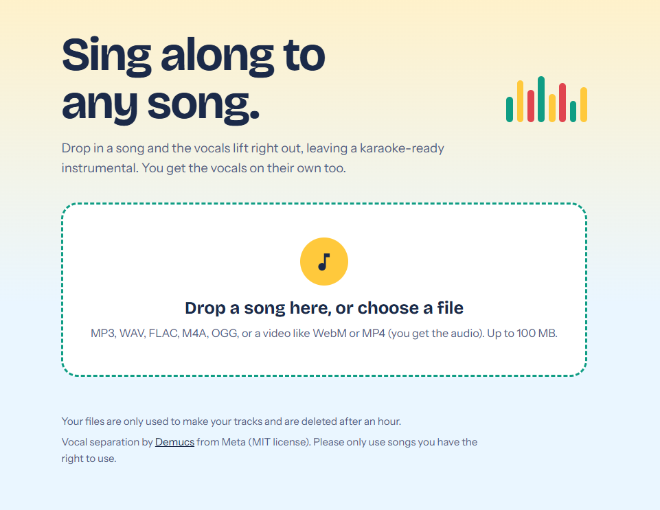
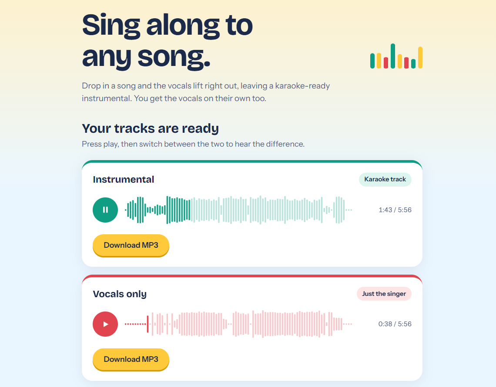

# Karaage 🍗🎤
### Fry the vocals. Keep the music.

Karaage is a simple, local web app that turns your favourite songs into karaoke tracks. Upload a song, let the vocals separate, and get two tracks: an instrumental for singing along and the original vocals on their own.

No account needed. Your computer does the processing.

📸 Preview

Upload a song



Your tracks, ready to play


## ✨ What can it do?

- 🎤 **Make karaoke tracks** — remove the vocals to create an instrumental.
- 🎧 **Isolate vocals** — listen to the singer without the backing music.
- ▶️ **Preview and compare** — play either track, explore its waveform, and jump to any point in the song.
- 💾 **Download your tracks** — save both results as MP3 files.
- 🎬 **Support audio and video** — upload a song or a video file; Karaage extracts the audio for processing.

## 🛠️ Getting started

Karaage runs on your own computer. Follow these steps to get it running locally.

### 1. Install the prerequisites

Before starting, install:

- **Python** — [Download Python](https://www.python.org/downloads/)
- **FFmpeg** — [Download FFmpeg](https://ffmpeg.org/download.html). On Windows, make sure it is added to your system's PATH.
- **Git** (optional) — [Download Git](https://git-scm.com/downloads), or download the repository as a ZIP file instead.

To check that Python and FFmpeg are available, open PowerShell and run:

```powershell
python --version
ffmpeg -version
```

### 2. Download Karaage

Clone the repository:

```powershell
git clone https://github.com/YOUR-USERNAME/karaage.git
cd karaage
```

Alternatively, download the repository as a ZIP from GitHub, extract it, and open PowerShell in the extracted project folder.

### 3. Set up the environment

Create a Python virtual environment and activate it:

```powershell
python -m venv .venv
.\.venv\Scripts\Activate.ps1
```

Install the required Python packages:

```powershell
python -m pip install -r requirements.txt
```

### 4. Run Karaage

Start the application:

```powershell
python app.py
```

Once the terminal shows that the server is running, open this address in your browser:

**http://127.0.0.1:5000**

Upload a song, wait for processing to finish, then preview and download your tracks.

Keep the terminal window open while using Karaage. Press `Ctrl + C` in the terminal when you want to stop the app.

## 💻 How it works

Karaage uses:

- **Python & Flask** — run the local web application.
- **Demucs** — separate vocals from the instrumental.
- **FFmpeg** — support audio processing and media conversion.
- **HTML, CSS & JavaScript** — provide the interface, waveform previews, playback, and downloads.

Demucs may download its model the first time it runs. Processing speed depends on your computer; a compatible GPU can help, while CPU processing may take longer.

## 🔒 Privacy and file cleanup

Karaage is designed for local use:

- Processing runs on your own computer; it does not require a hosted Karaage server.
- Uploaded originals are deleted after processing finishes, whether successful or not.
- Completed results are automatically deleted after approximately one hour.
- Temporary job files from a previous run are cleared when the application starts.

Avoid uploading files you do not have permission to use.

## 🧰 Troubleshooting

**Python or FFmpeg is not recognised**

Install the missing program, check that it is added to PATH where required, and reopen PowerShell.

**A Python module is missing**

Make sure your virtual environment is activated, then run:

```powershell
python -m pip install -r requirements.txt
```

**Processing fails or takes too long**

Check that FFmpeg works and that your computer has enough memory and processing power. Try a smaller file if necessary.

**The browser cannot connect**

Make sure `python app.py` is still running and open `http://127.0.0.1:5000`.

## 💛 Credits

Vocal separation is powered by [Demucs](https://github.com/facebookresearch/demucs), an open-source audio source-separation project.

Built as a hobby project for anyone who loves music and wants to sing along.

